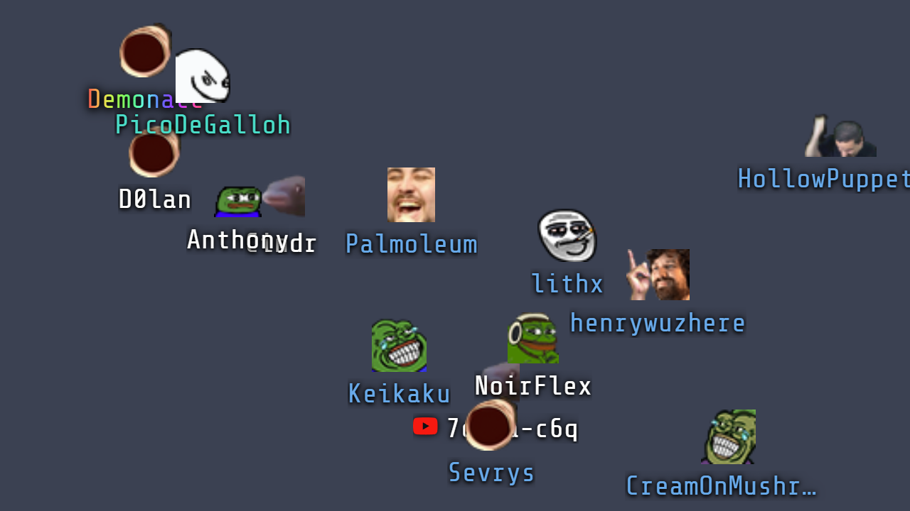
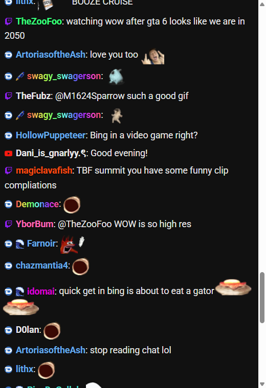
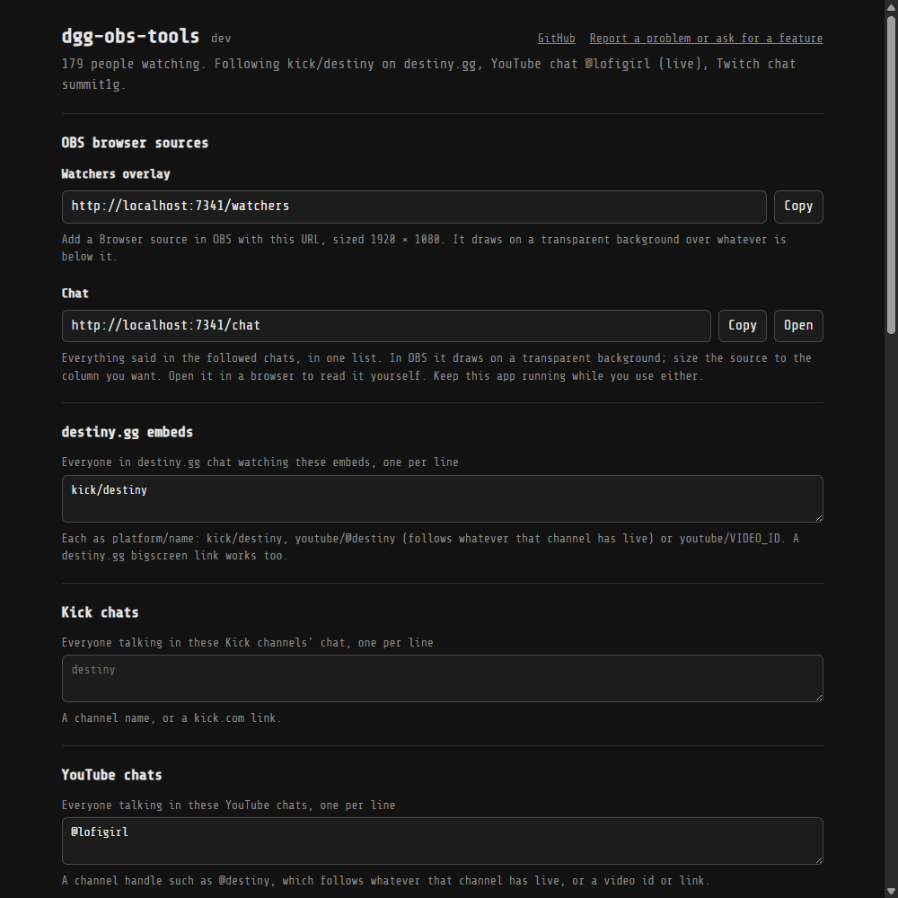

# dgg-obs-tools

OBS browser sources that draw destiny.gg, Kick, YouTube and Twitch chat on
your stream: an overlay of who is watching, and one combined chat. It's a
single small program: run it, say what to follow, and paste a URL into OBS.



## Watchers

Shows the people watching a stream as the last emote each of them used, with
their name in its chat colour. It draws from any mix of four sources, each
followed on its own:

- **destiny.gg embeds:** everyone in destiny.gg chat with that embed open
  (say `kick/destiny`).
- **Kick chats:** everyone talking in a Kick channel's chat.
- **YouTube chats:** everyone talking in a YouTube stream's chat. A channel
  handle such as `@destiny` follows whatever that channel has live.
- **Twitch chats:** everyone talking in a Twitch channel's chat.

Kick, YouTube and Twitch emotes are drawn from those sites' own pictures, and
a small platform icon can show where somebody is talking. The same name on two
platforms is two people.

Layouts include free float, a safe frame around the edges, a bottom rail, side
columns and bumper cars, plus options for speed, size, entrances and names.

## Chat



The followed chats as one combined chat: destiny.gg, Kick, YouTube and Twitch
messages in a single column, with each platform's emotes, name colours and a
small platform icon. Open it in a browser to read along, or add it to OBS,
where it draws on a transparent background.

Options on the setup page:

- which destiny.gg messages show: all of chat, only people watching the
  followed embeds, or none; and whether the Kick, YouTube and Twitch chats show
- highlighted phrases, and highlighting destiny.gg people who are watching
  the followed embeds
- what happens to a message a moderator removes or a user banned: hidden,
  blurred (hover to read, in a browser) or kept
- destiny.gg's flair badges beside names, and starring out swear words and slurs
- size, text shadow, platform icons, shortened links, and how many messages
  stay on screen

In a browser, scrolling up stops the chat moving so you can read back, and a
button takes you to the newest messages again. Very dark name colours, which
some people pick on Twitch and Kick, are lightened until they can be read.

Everything shown is already public in those chats. The app connects
anonymously and needs no login or API key. Kick and YouTube chat are read the
way their own web pages read them, which neither site documents, so a change
on their side can break that part until an update follows.

<br clear="right">

## Download

Get the file for your system from the
[latest release](https://github.com/StrawWaffle/dgg-obs-tools/releases/latest).
There's nothing to install: put it anywhere and run it.

- **Windows:** `dgg-obs-tools_windows_x64.exe` (or `_arm64.exe` on a Snapdragon
  laptop). The file isn't signed, so the first time Windows may say it
  protected your PC: click **More info**, then **Run anyway**.
- **macOS:** `dgg-obs-tools_macos_arm64.tar.gz` (Apple silicon) or
  `_macos_x64` (Intel). Unpack it, then the first time right-click the file
  and choose **Open**, because it isn't signed.
- **Linux:** `dgg-obs-tools_linux_x64.tar.gz` (or `_arm64`). Unpack and run.

It keeps itself up to date. A few times a day it checks for a new release,
verifies it against the release's checksums and puts it in place of its own
file. It never restarts by itself, so an update can't interrupt a stream: the
setup page and the tray menu offer a restart, and otherwise the next launch
uses the new version.

## Setup



1. Run `dgg-obs-tools`. It opens its setup page in your browser at
   `http://localhost:7341/`.
2. Fill in any of the four lists, one entry per line, and click **Save**:
   - **destiny.gg embeds** as `platform/name`: `kick/destiny`,
     `youtube/@destiny` or `youtube/VIDEO_ID`, or a `destiny.gg/bigscreen#...` link.
   - **Kick chats** as a channel name (`destiny`) or a kick.com link.
   - **YouTube chats** as a handle (`@destiny`), a video id, or a YouTube link.
   - **Twitch chats** as a channel name (`xqc`) or a twitch.tv link.

   Everything listed feeds both the overlay and the chat.
3. In OBS add a **Browser** source with the URL `http://localhost:7341/watchers`
   for the watchers overlay (sized 1920 × 1080), or `http://localhost:7341/chat`
   for the chat (any size you like).

It runs in the system tray (the menu bar on a Mac), with no window of its
own: click the icon to open the setup page. Right-click it to check for an
update (it downloads, installs and restarts in one go) or to quit. Keep it
running while you stream. Changes saved on the setup page show up in OBS
straight away. Running it a second time just opens the setup page of the copy
that's already running.

On Linux the icon needs a desktop that shows tray icons; on GNOME that means
the AppIndicator extension. Without one, the setup page has a **Quit** button.

Settings are kept in your user config folder (`%APPDATA%\dgg-obs-tools` on
Windows, `~/Library/Application Support/dgg-obs-tools` on macOS,
`~/.config/dgg-obs-tools` on Linux), so the program file can be moved or
replaced without losing them. The log of the latest run, `dgg-obs-tools.log`,
is kept in the same folder.

Options: `-port` serves on another port, and `-no-browser` skips opening the
setup page.

## Problems and ideas

[Open an issue](https://github.com/StrawWaffle/dgg-obs-tools/issues/new/choose)
to report something that isn't working or to ask for a feature; there's a form
for each. The setup page links there too. For a problem, the version (shown at
the top of the setup page) and the log file above help most.

## Why it runs on your machine

destiny.gg's chat socket refuses connections from any web page that isn't
destiny.gg, and an OBS browser source is a web page. So something outside the
browser has to hold the connection. This program does that and serves the
overlay and the chat to OBS on `localhost` only.

## Building

Needs Go and Node.

```sh
cd web && npm ci && npm run build && cd ..
go build -trimpath -ldflags "-s -w" -o dgg-obs-tools .
```

`npm run dev` in `web/` serves the pages with hot reload and forwards `/api`
to a copy of the program running on the default port.

Tests: `go test ./...` and `npm test` in `web/`.

To publish a release, push a tag such as `v0.2.0`. The release workflow builds
every platform with `scripts/build-release.sh` and attaches the files and
`checksums.txt`. Copies built from source report version `dev` and never
update themselves.
